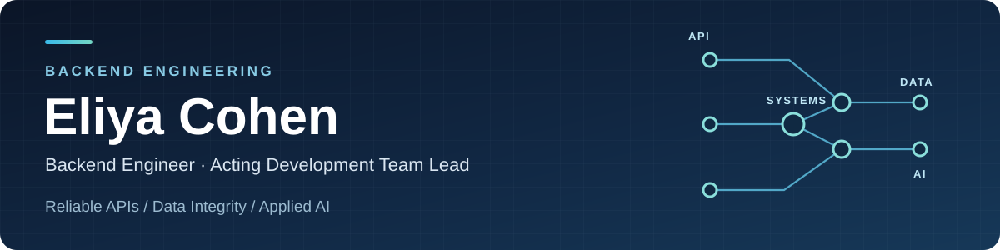

  

<strong>Backend Development · PostgreSQL · AI Integrations</strong>

I build backend applications and integrate AI services using **Node.js, TypeScript, Python, and PostgreSQL**. I care about clear APIs, validation, automated testing, and maintainable code. As a development team lead, I coordinate developers, drive technical decisions, and help move projects forward.

### 🛠️ Core Technologies

  
  
  
  
  
  
  

### 🧭 What I Work With

| Area | Tools & Practices |
| --- | --- |
| **Backend & APIs** | Node.js, Express, TypeScript, Python, REST APIs, Zod |
| **Databases** | PostgreSQL, SQL, Prisma |
| **Testing & Delivery** | Git, Docker, Linux, GitHub Actions, Vitest, Playwright |
| **AI Integrations** | LLM APIs, LangChain, streaming responses, RAG |

### 🚀 Selected Projects

| Project | Engineering Highlights |
| --- | --- |
| **[LLM Arena](https://github.com/Eliya25/llm-arena)** | Independent LLM streams, PostgreSQL persistence, retry handling, authorization and observability |
| **[Lumière](https://github.com/Eliya25/lumiere-ai-movie-concierge)** | Validated AI output, external API enrichment, failure isolation, caching and automated tests · [Live demo](https://lumiere-ai-movie-concierge.vercel.app/) |
| **[RAG PDF Assistant](https://github.com/Eliya25/rag-pdf-demo)** | Python, local embeddings, custom vector search and page-aware retrieval |

### 📚 Currently Learning More About

Distributed systems · System design · AWS · Networking · Operating systems

B.Sc. in Computer Science · Building and learning beyond the happy path.

